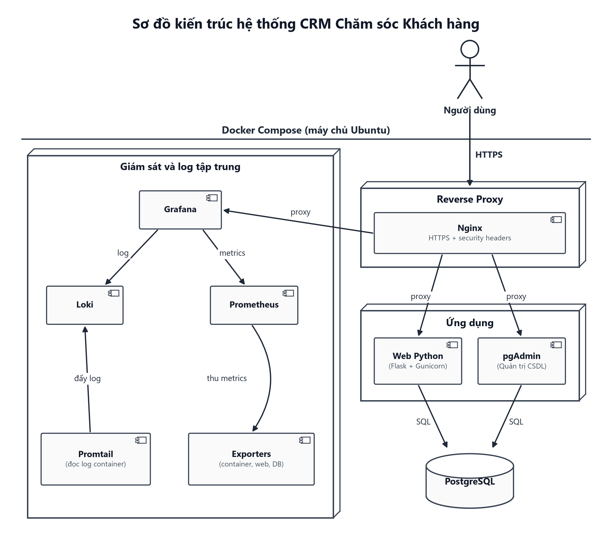

# Hệ Thống CRM Chăm Sóc Khách Hàng

Bài tập lớn môn học: **Triển khai và Quản trị Hệ thống Phần mềm**  
Học viên: **NGUYEN THI QUYNH THO**  
Mã số sinh viên (MSSV): **dtc245340007**  
Đề tài 4: **Hệ thống CRM Chăm sóc Khách hàng**  
Repository GitHub: `git@github.com:dtc245340007-collab/dtc245340007-crm-devops.git`

---

## 1. Giới thiệu Đề tài & Nghiệp vụ Hệ thống

Hệ thống CRM Chăm sóc Khách hàng là giải pháp phần mềm quản trị quan hệ khách hàng nội bộ dành cho doanh nghiệp, hỗ trợ:
- **Quản lý Khách hàng & Người liên hệ:** Lưu trữ hồ sơ công ty, thông tin liên hệ chính, phân loại trạng thái (lead, active, inactive).
- **Nhật ký Tương tác:** Ghi nhận toàn diện các hoạt động chăm sóc (cuộc gọi, email, họp trực tiếp, ghi chú nghiệp vụ) và hẹn lịch chăm sóc tiếp theo.
- **Phân quyền người dùng (Role-Based Access Control):**
  - **Quản lý (Manager):** Quản trị danh mục khách hàng, phân công người phụ trách, quản lý tài khoản nhân viên (tạo mới, khóa/mở tài khoản, đặt lại mật khẩu) và theo dõi báo cáo phân tích toàn công ty.
  - **Nhân viên CSKH (Staff):** Đăng nhập, theo dõi và quản lý các khách hàng được phân công phụ trách, thêm người liên hệ và ghi nhận nhật ký tương tác của mình.

---

### Danh mục Commit chuẩn theo Yêu cầu Đề bài

| Giai đoạn | Tên Commit trên GitHub | Nội dung thực hiện theo Đề tài | Trạng thái |
| :---: | :--- | :--- | :---: |
| **Commit 1** | `Commit 1: Trien khai Web CRM, PostgreSQL, pgAdmin va Nginx Reverse Proxy (HTTPS + Security Headers)` | Triển khai Web CRM Flask, CSDL PostgreSQL 16, pgAdmin 4 và Nginx Reverse Proxy HTTPS/Security Headers | Hoàn thành |
| **Commit 2** | `Commit 2: Tich hop Prometheus, Grafana va cac Exporters giam sat Container, Web Server, Database` | Tích hợp Prometheus, Grafana, cAdvisor, Nginx Exporter, Postgres Exporter | Hoàn thành |
| **Commit 3** | `Commit 3: Trien khai Loki Promtail va hoan thien he thong` | Triển khai Loki + Promtail, LogQL, Hardening hệ thống, kịch bản cảnh báo sự cố và tài liệu báo cáo | Hoàn thành |

---

## 2. Sơ đồ Kiến trúc Hệ thống



---

## 3. Cấu trúc Thư mục Dự án

```text
dtc245340007-crm-devops/
├── alert-sink/                 # Webhook receiver nhận payload cảnh báo sự cố từ Grafana
│   ├── app.py                  # Dịch vụ Python Flask xử lý alert webhook
│   └── Dockerfile              # Dockerfile dịch vụ alert-sink (chạy Non-root)
├── db/                         # Cấu hình khởi tạo và phân quyền Cơ sở dữ liệu PostgreSQL
│   ├── 01-init.sh              # Script tự động tạo vai trò (roles), cơ sở dữ liệu và phân quyền
│   ├── fix_utf8.sql            # Script đồng bộ collation và bảng mã UTF-8 tiếng Việt
│   └── init.sql                # Lược đồ bảng (schema) và dữ liệu mẫu ban đầu (seed data)
├── docs/                       # Tài liệu thiết kế kiến trúc, báo cáo và quy trình xử lý sự cố
│   ├── BAO_CAO_DO_AN_CRM_DEVOPS.md # Báo cáo toàn diện đồ án DevOps (8 chương chuẩn mực)
│   ├── cho-bao-cao.md          # Tài liệu tổng hợp các bảng thông số phục vụ báo cáo
│   ├── so_do_kien_truc_crm.png # Sơ đồ kiến trúc tổng thể toàn hệ thống CRM (ảnh PNG)
│   ├── so_do_kien_truc_crm.svg # Sơ đồ kiến trúc dạng vector (SVG)
│   └── su-co-bruteforce.md     # Tài liệu điều tra và quy trình xử lý sự cố Brute-force
├── evidence/                   # Minh chứng kết quả kiểm thử thực tế từng bước triển khai
│   ├── buoc0-moitruong.txt     # Bằng chứng cấu hình máy chủ, kernel và Docker
│   ├── buoc12-web-db.txt       # Bằng chứng kiểm tra Web Flask và PostgreSQL
│   ├── buoc3-nginx.txt         # Bằng chứng Nginx SSL, HTTPS và Rate Limiting
│   ├── buoc4-giamsat.txt       # Bằng chứng Prometheus targets và cAdvisor
│   ├── buoc5-logql.txt         # Bằng chứng thực thi các câu truy vấn LogQL
│   ├── buoc5-sucodo.txt        # Bằng chứng giả lập tấn công và Alert firing
│   ├── buoc6-hardening.txt     # Bằng chứng kiểm tra an ninh và Least Privilege
│   └── final-smoke-test.txt    # Bằng chứng chạy kiểm thử toàn trình (Smoke Test)
├── grafana/                    # Cấu hình tự động nạp (Provisioning) Grafana
│   └── provisioning/
│       ├── alerting/           # Contact points, notification policies và alerting rules
│       ├── dashboards/         # 4 Dashboard chuyên dụng (Containers, Nginx, Postgres, Logs)
│       └── datasources/        # Khai báo sẵn nguồn dữ liệu Prometheus và Loki
├── loki/                       # Cấu hình máy chủ lưu trữ và lập chỉ mục nhật ký tập trung
│   └── loki-config.yaml        # Cấu hình retention, storage filesystem và limits
├── nginx/                      # Nginx Reverse Proxy và điểm kết thúc HTTPS
│   ├── certs/                  # Thư mục chứa chứng chỉ SSL/TLS tự ký (server.crt, server.key)
│   ├── gen-cert.sh             # Script tự động sinh chứng chỉ SSL/TLS có cấu hình SAN
│   └── nginx.conf              # Cấu hình Reverse proxy, SSL, Security headers, Rate limit
├── pgadmin/                    # Cấu hình quản trị cơ sở dữ liệu qua giao diện web
│   └── servers.json            # Tự động nạp kết nối PostgreSQL vào pgAdmin 4
├── prometheus/                 # Cấu hình hệ thống giám sát số liệu (Metrics)
│   └── prometheus.yml          # Cấu hình 4 scrape jobs (cadvisor, nginx, postgres, prometheus)
├── promtail/                   # Promtail Log Agent thu gom nhật ký container
│   └── promtail-config.yaml    # Docker service discovery và đẩy log về Loki
├── scripts/                    # Tập lệnh tự động hóa kiểm thử, giả lập sự cố và cấu hình
│   ├── run_clean_slate_test.sh # Script kiểm thử triển khai từ trạng thái sạch (Clean-slate)
│   ├── set_default_credentials.sh # Script đồng bộ tài khoản mặc định vào môi trường
│   ├── simulate_bruteforce.sh  # Script mô phỏng tấn công Brute-force kích hoạt cảnh báo
│   ├── smoke_test.py           # Script tự động hóa kiểm thử hồi quy toàn diện 5 giai đoạn
│   └── test_monitoring.sh      # Script kiểm tra nhanh sức khỏe các dịch vụ giám sát
├── web/                        # Mã nguồn ứng dụng web CRM (Python Flask)
│   ├── src/
│   │   ├── static/             # Tệp tĩnh CSS và tài nguyên giao diện
│   │   ├── templates/          # Giao diện Jinja2 (customers, interactions, users, reports)
│   │   ├── app.py              # Logic ứng dụng Flask, phân quyền RBAC và session security
│   │   ├── auth.py             # Quản lý xác thực người dùng và mật khẩu băm scrypt
│   │   └── db.py               # Kết nối và thao tác CSDL PostgreSQL (connection pool)
│   ├── Dockerfile              # Multi-stage build tối ưu, Non-root user (appuser UID 10001)
│   └── requirements.txt        # Danh sách thư viện Python phụ thuộc
├── docker-compose.yml          # Tệp điều phối toàn bộ 12 dịch vụ, 3 mạng nội bộ và volumes
├── .env.example                # Mẫu biến môi trường an toàn với các giá trị placeholder
├── .gitignore                  # Cấu hình loại trừ file nhạy cảm (.env, certs, DB volumes)
└── README.md                   # Tài liệu hướng dẫn triển khai, vận hành và quản trị hệ thống
```

---

## 4. Yêu cầu Hệ thống

- **Hệ điều hành:** Ubuntu Linux 22.04 LTS / 24.04 LTS / 26.04.
- **Phần cứng khuyến nghị:** CPU 2 Cores, RAM tối thiểu 4GB (khuyến nghị 6GB+), Dung lượng đĩa trống tối thiểu 15GB.
- **Công cụ yêu cầu:** Docker Engine (>= 24.0), Docker Compose v2 (>= 2.20), OpenSSL, cURL, Git, UFW.

---

## 5. Hướng dẫn Cài đặt & Khởi chạy Nhanh

### Bước 1: Sao chép mã nguồn (Clone Repository)
```bash
git clone git@github.com:dtc245340007-collab/dtc245340007-crm-devops.git ~/crm
cd ~/crm
```

### Bước 2: Thiết lập Biến môi trường & Sinh Khóa Phiên An toàn
Sao chép file mẫu `.env.example` thành file cấu hình bảo mật `.env` và phân quyền bảo mật:
```bash
cp .env.example .env
chmod 600 .env
```
*Lưu ý bảo mật về `SECRET_KEY`: Trong môi trường production, ứng dụng Flask sẽ kiểm tra nghiêm ngặt và từ chối khởi động nếu `SECRET_KEY` bị thiếu, dùng giá trị mặc định, hoặc ngắn hơn 32 ký tự. Hãy tạo khóa ngẫu nhiên an toàn bằng một trong hai lệnh sau và dán vào biến `SECRET_KEY` trong file `.env`:*
```bash
# Cách 1: Dùng OpenSSL (khuyên dùng)
openssl rand -hex 32

# Cách 2: Dùng module secrets của Python 3
python3 -c "import secrets; print(secrets.token_hex(32))"
```

### Bước 3: Tự sinh Chứng chỉ SSL/TLS cho Nginx
Tự động tạo cặp khóa RSA 2048-bit và chứng chỉ tự ký có SAN (`IP:192.168.207.128`, `DNS:localhost`) bằng script:
```bash
chmod +x nginx/gen-cert.sh
./nginx/gen-cert.sh
```

### Bước 4: Khởi chạy Toàn bộ Hệ thống bằng Một Lệnh
Khởi chạy và xây dựng toàn bộ 12 dịch vụ:
```bash
docker compose up -d --build
```
Kiểm tra trạng thái các container:
```bash
docker compose ps
```
Theo dõi log thời gian thực của các dịch vụ quan trọng:
```bash
# Theo dõi toàn bộ log hệ thống:
docker compose logs -f

# Theo dõi từng dịch vụ cụ thể:
docker compose logs -f web
docker compose logs -f nginx
docker compose logs -f alert-sink
```

---

## 6. Hướng dẫn Kiểm tra Hoạt động & Sử dụng Nghiệp vụ CRM

### 6.1. Kiểm tra Cơ sở Dữ liệu PostgreSQL
Kiểm tra kết nối và dữ liệu khởi tạo (seed data) trong database `crm`:
```bash
docker compose exec db psql -U crm_admin -d crm -c "SELECT count(*) AS total_customers FROM customers;"
docker compose exec db psql -U crm_admin -d crm -c "SELECT username, role, is_active FROM users;"
```

### 6.2. Hướng dẫn Sử dụng Ứng dụng theo Vai trò

#### Vai trò Quản lý (Manager)
1. Đăng nhập tài khoản `admin` (mật khẩu lấy từ `.env`).
2. **Quản lý Khách hàng:** Xem toàn bộ khách hàng trong công ty, bấm **Thêm khách hàng** (`/customers/new`) để nhập thông tin và phân công nhân viên phụ trách.
3. **Quản lý Nhân viên:** Truy cập menu **Nhân viên** (`/users`), tạo tài khoản nhân viên mới, khóa/mở khóa tài khoản hoặc đặt lại mật khẩu ngẫu nhiên.
4. **Báo cáo Thống kê:** Truy cập menu **Báo cáo** (`/reports`) để xem phân bổ trạng thái khách hàng và tổng hợp hoạt động tương tác.

#### Vai trò Nhân viên CSKH (Staff)
1. Đăng nhập tài khoản `nhanvien01` hoặc `nhanvien02` (mật khẩu lấy từ `.env`).
2. Hệ thống chỉ hiển thị danh mục khách hàng **được phân công cho nhân viên đó**.
3. Bấm vào chi tiết khách hàng để xem thông tin, bấm **Thêm liên hệ** để bổ sung contact mới, hoặc bấm **Ghi nhận tương tác** để lưu lại nhật ký cuộc gọi/email/ghi chú kèm thời gian hẹn lịch chăm sóc tiếp theo.

---

## 7. Giám sát & Quản trị Nhật ký Tập trung

### 7.1. Kiểm tra Trạng thái Prometheus Targets
Kiểm tra sức khỏe toàn bộ 4 scrape jobs (`cadvisor`, `nginx`, `postgres`, `prometheus`) đều ở trạng thái UP:
```bash
docker compose exec prometheus wget -qO- http://localhost:9090/api/v1/targets | jq '.data.activeTargets[] | {job: .labels.job, health: .health}'
```

### 7.2. Dashboards Giám sát trên Grafana
Truy cập `https://localhost/grafana/` (hoặc `https://<IP_MAY_CHU>/grafana/`) > vào thư mục **CRM**, hệ thống đã nạp sẵn 4 Dashboard chuyên dụng:
1. **CRM - Containers:** Giám sát thời gian thực CPU %, RAM bytes, Network I/O của toàn bộ 12 containers qua cAdvisor.
2. **CRM - Nginx:** Giám sát lưu lượng HTTP requests, active connections, băng thông qua Nginx Prometheus Exporter.
3. **CRM - PostgreSQL:** Giám sát số transactions commit/rollback, cache hit ratio, số kết nối mở của database.
4. **CRM - Logs:** Giám sát tập trung các dòng log, biểu đồ số lần `LOGIN_FAILED/phút`, biểu đồ top mã HTTP Nginx và log lỗi PostgreSQL.

### 7.3. Tập lệnh Truy vấn LogQL Tiêu chuẩn trên Loki
Có thể thực thi trực tiếp trên giao diện **Grafana Explore** (chọn Datasource: `Loki`) hoặc gửi qua cURL:
- **Q1 (Lỗi HTTP 5xx Nginx):**
  ```logql
  {job="nginx"} |~ "\" 5[0-9]{2} "
  ```
- **Q2 (Lỗi/Ngoại lệ Ứng dụng Web):**
  ```logql
  {job="webapp"} |~ "(?i)(error|exception|fail)"
  ```
- **Q3 (Đăng nhập thất bại):**
  ```logql
  {job="webapp"} |= "LOGIN_FAILED"
  ```
- **Q4 (Thống kê số lần đăng nhập thất bại theo phút):**
  ```logql
  sum(count_over_time({job="webapp"} |= "LOGIN_FAILED" [1m]))
  ```
- **Q5 (Lỗi CSDL PostgreSQL):**
  ```logql
  {job="postgres"} |~ "(?i)(error|fatal|panic)"
  ```

---

## 8. Kịch bản Mô phỏng Sự cố An toàn Thông tin & Cảnh báo

Hệ thống thiết lập kịch bản phát hiện và ngăn chặn tấn công dò quét mật khẩu (Brute-Force Attack):

### 8.1. Chạy Script Tấn công Giả lập
Thực thi script gửi dồn dập 20 yêu cầu sai mật khẩu vào tài khoản `admin`:
```bash
chmod +x scripts/simulate_bruteforce.sh
./scripts/simulate_bruteforce.sh
```

### 8.2. Quan sát Kích hoạt Cảnh báo (Alert Firing)
- Khi số lần nhập sai vượt ngưỡng 5 lần/phút, luật cảnh báo `CRM_BruteForce_Detected` trên Grafana Alerting tự động chuyển sang trạng thái **Firing**.
- Webhook notification tự động được phát tới dịch vụ `alert-sink:5000/alert`.
- Kiểm tra log cảnh báo tức thời:
  ```bash
  docker compose logs alert-sink --tail 25
  ```

### 8.3. Cơ chế Giảm thiểu & Chặn đứng (Mitigation)
- Nginx Rate Limiting được kích hoạt tại `location = /login`: Giới hạn 5 requests/phút (burst=10 nodelay).
- Từ các yêu cầu vượt ngưỡng trở đi, Nginx chủ động từ chối và trả về mã lỗi **HTTP 429 Too Many Requests**, ngăn chặn tuyệt đối nguy cơ cạn kiệt tài nguyên ứng dụng.
- Chi tiết báo cáo sự cố được lưu tại `docs/su-co-bruteforce.md`.

---

## 9. Bộ Giải pháp Củng cố Bảo mật (Hardening Checklist)

1. **Nguyên tắc Non-root & Least Privilege:**
   - **Các dịch vụ ứng dụng chạy Non-root:** Web (`appuser` UID 10001), Nginx (`nginx` UID 101), Grafana (`grafana` UID 472), Prometheus & Exporters (`nobody` UID 65534), pgAdmin (`pgadmin` UID 5050), Loki & Alert-Sink (UID 10001), PostgreSQL (`postgres` UID 999).
   - **Giải trình kỹ thuật đặc thù cho Promtail (`user: root`):** Thư mục chứa log container của Docker daemon trên máy chủ (`/var/lib/docker/containers`) có quyền mặc định là `0710 (drwx--x--- root:root)` và các file `*-json.log` là `0640 (-rw-r----- root:root)`. Do quyền hạn cấp cho nhóm khác (`others`) hoàn toàn bằng 0, người dùng non-root (kể cả UID 10001 hay group docker) đều bị nhân Linux chặn truy cập với lỗi `Permission denied`. Do đó Promtail bắt buộc phải chạy dưới `user: root` để có thể thu thập log của các containers.
   - **Biện pháp cô lập & phòng thủ chiều sâu đối với Promtail:**
     * Toàn bộ bind mounts (`/var/run/docker.sock` và `/var/lib/docker/containers`) đều được mount ở chế độ chỉ đọc (`:ro`).
     * Thu hồi toàn bộ quyền Linux Capabilities: `cap_drop: [ALL]`.
     * Chặn triệt để leo thang đặc quyền: `security_opt: [no-new-privileges:true]`.
     * Cô lập mạng nội bộ: Promtail chỉ kết nối trong mạng `monitoring` (internal: true), không mở hay publish bất kỳ cổng nào ra máy chủ hay mạng ngoài.
     * Giới hạn tài nguyên: `mem_limit: 128m`, `cpus: 0.5`.
   - **Phân tích rủi ro an ninh đối với Docker Socket (`/var/run/docker.sock`):**
     * *Lưu ý kỹ thuật quan trọng:* Trên Linux, việc gắn cờ `:ro` khi bind mount Unix Domain Socket (`/var/run/docker.sock:ro`) **không** đồng nghĩa với việc Docker API bị giới hạn chỉ đọc (read-only). Một Unix domain socket là kênh giao tiếp hai chiều (duplex IPC); bất kỳ tiến trình nào kết nối được tới socket đều có thể gửi HTTP request (bao gồm cả POST/DELETE) tới Docker Engine.
     * *Kiểm soát rủi ro thực tế trong đồ án:* Promtail chỉ sử dụng socket cho cơ chế khám phá container (`docker_sd_configs`). Để giảm thiểu rủi ro, container đã bị tước bỏ mọi capabilities, bật `no-new-privileges`, cô lập trong mạng riêng không mở cổng. Trong môi trường production doanh nghiệp mở rộng, khuyến nghị sử dụng proxy chuyên dụng (như `docker-socket-proxy` cấu hình `POST=0, DELETE=0`) hoặc chuyển sang thu thập log qua Syslog/Fluentbit driver để không cần mount Docker socket.
2. **Network Isolation:** Phân tách 3 mạng bridge `crm_frontend`, `crm_backend` (`internal: true`) và `crm_monitoring` (`internal: true`). Database hoàn toàn không nối mạng ngoài và không publish cổng.
3. **Database Least Privilege:** Role `crm_app` chỉ có quyền DML (`SELECT, INSERT, UPDATE, DELETE`) trên schema `public`, bị thu hồi toàn bộ quyền DDL (`DROP/CREATE TABLE` bị từ chối). Cấu hình mã hóa mật khẩu `scram-sha-256`.
4. **Hạn chế Quyền Container & Read-only Rootfs:** Áp dụng `no-new-privileges:true` và `cap_drop: [ALL]` trên toàn bộ containers; áp dụng `read_only: true` cho hệ thống tệp gốc (rootfs) đối với các service phi trạng thái (`web`, `nginx`, `nginx-exporter`, `postgres-exporter`, `alert-sink`) kết hợp `tmpfs` an toàn (`/tmp:rw,noexec,nosuid`); các service lưu trữ trạng thái (`db`, `grafana`, `loki`, `pgadmin`, `prometheus`) sử dụng Docker named volume chuyên biệt và được giới hạn hạn ngạch tài nguyên (CPU/RAM).
5. **Nginx Security Headers & Version Hiding:** Cấu hình đầy đủ HSTS, CSP, X-Frame-Options, X-Content-Type-Options; bật `server_tokens off;` và ẩn các headers `Server`, `X-Powered-By`. Bảo vệ cookie phiên `SESSION_COOKIE_SECURE = True`, `HttpOnly`, `SameSite=Lax`.
6. **Tường lửa UFW:** Bật tường lửa hệ thống với chính sách `default deny incoming`, chỉ cho phép cổng 22, 80 và 443.
7. **Quản lý Bí mật & Mật khẩu Mạnh:** Toàn bộ mật khẩu được đặt mạnh mẽ và phân tách độc lập cho từng dịch vụ trong file `.env` (`chmod 600`), không ghi cứng mật khẩu trong mã nguồn/script khởi tạo (`01-init.sh`), mật khẩu người dùng seed được băm an toàn bằng scrypt (`werkzeug.security`).

Kiểm tra toàn bộ các biện pháp trên bằng tập lệnh:
```bash
chmod +x scripts/generate_buoc6_evidence.sh
./scripts/generate_buoc6_evidence.sh
```

---

## 10. Hướng dẫn Dừng & Xóa Hệ thống

- **Dừng hệ thống (giữ nguyên dữ liệu):**
  ```bash
  docker compose down
  ```
- **Dừng và xóa toàn bộ dữ liệu volumes (chế độ xóa sạch):**
  ```bash
  docker compose down -v
  ```

---

## 11. Xử lý Sự cố Thường gặp (Troubleshooting)

1. **Lỗi Role Exporter khi Volume CSDL đã tồn tại từ trước:**
   Script `01-init.sh` chỉ chạy khi khởi tạo volume mới. Nếu volume DB đã có từ trước, chạy lệnh sau để bổ sung role `exporter`:
   ```bash
   docker compose exec db psql -U crm_admin -d crm -c "
   DO \$\$
   BEGIN
     IF NOT EXISTS (SELECT FROM pg_roles WHERE rolname = 'exporter') THEN
       CREATE ROLE exporter WITH LOGIN PASSWORD 'Mật_khẩu_trong_env';
       GRANT pg_monitor TO exporter;
     END IF;
   END \$\$;
   "
   ```
2. **Lỗi Docker API Version trên cAdvisor hoặc Promtail:**
   Trên Ubuntu 24.04/26.04 sử dụng Docker Engine mới, Docker API yêu cầu phiên bản `>= 1.44`. Đã xử lý bằng biến môi trường `DOCKER_API_VERSION=1.44` trong compose cho cAdvisor và sử dụng image `grafana/promtail:3.0.0`.
3. **Lỗi Quyền Đọc Volume Provisioning của Grafana:**
   Grafana chạy dưới user UID 472. Nếu Grafana không đọc được dashboards, chạy lệnh:
   ```bash
   chmod -R a+rX ./grafana
   docker compose restart grafana
   ```
4. **Xung đột Cổng 80 trên Máy chủ Host:**
   Nếu Ubuntu có cài sẵn `nginx.service` chiếm cổng 80, tắt dịch vụ host:
   ```bash
   sudo systemctl stop nginx && sudo systemctl disable nginx
   ```
